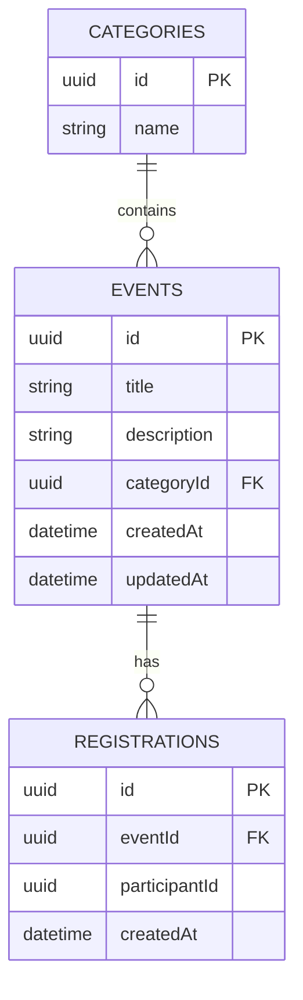

# Ресурсна карта CampusHub

| Ресурс | Призначення | Поля |
| --- | --- | --- |
| events | Університетські події | id: UUID, title: string, description: string, categoryId: UUID, createdAt: ISO date-time, updatedAt: ISO date-time |
| categories | Категорії подій | id: UUID, name: string |
| registrations | Участь у події | id: UUID, eventId: UUID, participantId: UUID, createdAt: ISO date-time |

## Зв’язки

- Одна категорія містить від нуля до багатьох подій.
- Кожна подія належить рівно одній наявній категорії.
- Одна подія має від нуля до багатьох реєстрацій.
- Кожна реєстрація пов’язує одного учасника з однією подією.
- Один учасник може мати реєстрації на різні події.
- Пара eventId + participantId унікальна.
- Окремого ресурсу participants немає: participantId — UUID, який надсилає клієнт.

## Цілісність даних

Невідомий categoryId відхиляється з 400. Реєстрація на відсутню подію — 404.
Дубльована пара eventId + participantId — 409.
Під час видалення події її реєстрації теж видаляються; інші події та їхні реєстрації не змінюються.

Категорії завантажуються в Map при запуску. Події та реєстрації спочатку порожні.
Усі дані ізольовані в межах одного процесу; після перезапуску зникають.
